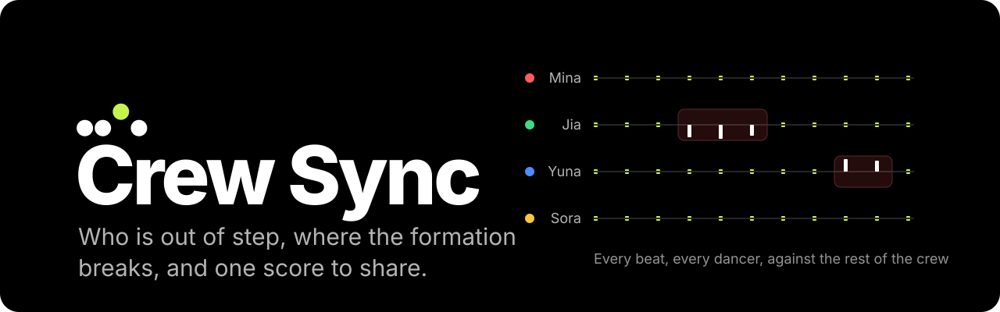
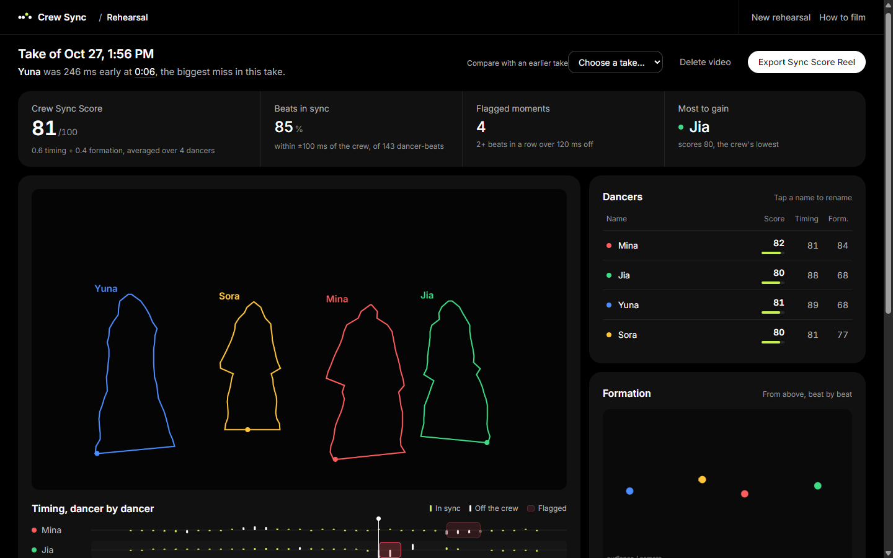
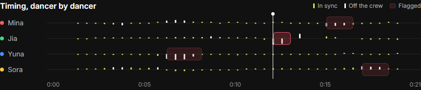
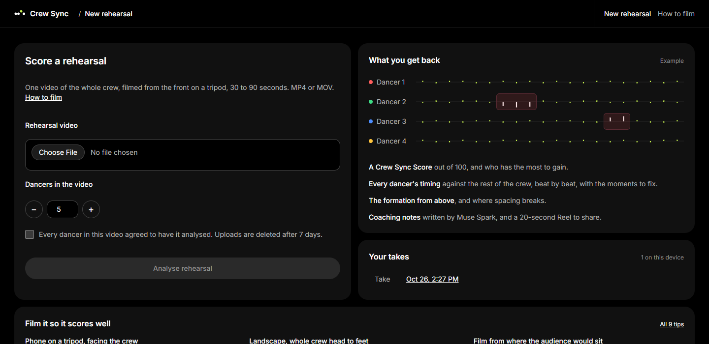
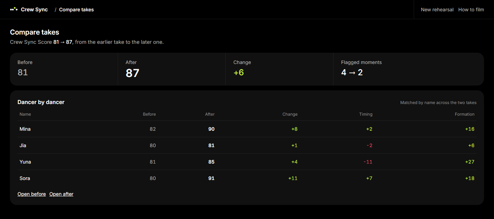

<p align="center">
  
</p>

<p align="center">
  <a href="https://github.com/zenith4eva/crew-sync/actions/workflows/test.yml"></a>
  
  
  
</p>

**Crew Sync turns one phone video of a dance crew's run-through into a coach's notes.** It tracks every dancer with SAM 3.1, measures each one's timing against the rest of the crew beat by beat, checks the formation from above, and tells you who to fix first. Then it hands you a 20-second Sync Score Reel to post.

A crew that is late together still scores 100. Crew Sync looks for the one dancer who isn't with the others, which is what a choreographer's eye does and what nobody can see at full speed.

Built for the Meta Global AI Developer Hackathon (indie track), October 26 to November 4, 2026. All code was written during the hackathon.

https://github.com/user-attachments/assets/65bc6772-1c9b-4b11-807b-1d2c4e7d4912

<p align="center"><sub>70 s demo, turn the sound on · <a href="https://github.com/zenith4eva/crew-sync/releases/download/demo/crew-sync-demo.mp4">1080p download</a> · footage on Pexels: Westside Full, khanhhoangminh, Gustavo Fring, Anya Juarez · music: NickPanek on Pixabay</sub></p>



<sub>Dancer footage is hidden in these screenshots; the outlines are SAM 3.1's masks.</sub>

## What you get back

| | |
| --- | --- |
| **One crew score** | A Crew Sync Score out of 100 (0.6 timing, 0.4 formation), who has the most to gain, and the biggest miss in plain words. |
| **Every dancer, every beat** | The sync strip: one lane per dancer, a tick per beat. Lime is with the crew, white is off it, a red band is a flagged moment. Click a band to jump the video there. |
| **The formation from above** | Feet positions on a top-down map, with drift since the last beat and who leaves their spot or the line. |
| **Coaching notes** | Three to five fixes written by Muse Spark from the numbers, each tied to a dancer and a moment. |
| **Before and after** | Pick an earlier take to see the crew score and every named dancer's change. |
| **A Reel to share** | 20 s, 9:16: the score reveal, the moment to fix, the crew in outline. It never names a dancer. |



<table>
  <tr>
    <td width="50%"></td>
    <td width="50%"></td>
  </tr>
  <tr>
    <td>Upload one take. Say how many dancers.</td>
    <td>Next rehearsal: see who got better.</td>
  </tr>
</table>

## Try it in two minutes

macOS or Linux:

```bash
git clone https://github.com/zenith4eva/crew-sync && cd crew-sync
python3.11 -m venv .venv && .venv/bin/pip install -r requirements.txt
(cd backend/meta && npm install) && (cd frontend && npm install && npm run build)
.venv/bin/python -m eval.make_synthetic data/synthetic.mp4   # a test clip with known answers, no API key needed
.venv/bin/python -m uvicorn backend.api.app:app --port 8000
```

Windows (Git Bash):

```bash
git clone https://github.com/zenith4eva/crew-sync && cd crew-sync
py -3.11 -m venv .venv && .venv/Scripts/pip install -r requirements.txt
(cd backend/meta && npm install) && (cd frontend && npm install && npm run build)
.venv/Scripts/python -m eval.make_synthetic data/synthetic.mp4
.venv/Scripts/python -m uvicorn backend.api.app:app --port 8000
```

Open http://localhost:8000 and upload `data/synthetic.mp4` with 5 dancers. With a Meta Model API key in `.env` (see [Run it](#run-it)), upload your own crew.

### On an iPhone

The app runs in Safari; the server runs on your computer. Start it so other devices on your Wi-Fi can reach it:

```bash
.venv/bin/python -m uvicorn backend.api.app:app --host 0.0.0.0 --port 8000
```

Then open `http://<your computer's IP>:8000` on the phone (on a Mac, `ipconfig getifaddr en0` prints the IP). Upload picks straight from the camera roll; iPhone `.mov` clips (HEVC) are converted before tracking. Film in 1080p: uploads are capped at 500 MB and 90 s. `--host 0.0.0.0` exposes the app to everyone on that network, so use it on a network you trust; for anything wider, deploy the Docker image behind HTTPS.

## How it works

1. **Track:** SAM 3.1 (Meta Model API) segments every dancer with the prompt "person" and keeps each identity across the clip.
2. **Beat grid:** librosa finds the beats in the audio. You can set the BPM and first beat by hand when rehearsal audio is noisy or missing.
3. **Timing:** each dancer's motion signal (the change in frame-to-frame mask movement, which peaks on the beat) is cross-correlated with the rest of the crew's around every beat. The lag is that dancer's offset. A crew that is late together still scores 100.
4. **Formation:** feet points (bottom of each mask) give a top-down map. On each beat where the crew holds a formation (not walking to a new one), it checks that each dancer holds the spot they took at the start of that hold (overall shift and scale removed, so a V or staggered rows count as much as a line) and, when the crew is in a line, their distance from it. The line fit ignores dancers who are off it.
5. **Score:** dancer score = 0.6 timing + 0.4 formation. The crew score is the mean.
6. **Coaching:** Muse Spark turns the numbers into 3 to 5 fixes as structured JSON. If Muse is unavailable, the notes are built from the numbers and labelled as such.
7. **Share:** a 20 s, 9:16 Sync Score Reel with the score reveal, the worst moment and the crew with outlines. It shows only the crew number and never names a dancer.
8. **Before and after:** pick an earlier take on the results page to see the crew score and each named dancer's change.
9. **Reference take (optional):** upload the leader's or the official video to score against it instead of the crew. The two takes are aligned by cross-correlating their audio, a mirror switch handles mirror-mode practice videos, and dancers are matched to reference dancers on the opening formation (editable). Timing is then measured against each dancer's match, and formation is each dancer's distance from their match's spot after removing overall shift and scale. The reference video is deleted as soon as it is tracked and is never shown or put in the Reel.
10. **Body pose (optional):** SAM 3D Body (open weights, run locally on a GPU) estimates each dancer's 3D joints every 0.25 s, using SAM 3.1's boxes. Each limb's direction in the dancer's own torso frame is compared with the crew's, so a dancer facing a little differently isn't penalized. Limbs more than 25° off are flagged, and the score weights become 0.4 timing, 0.3 formation, 0.3 pose.

The app also warns when the camera moves (phase correlation on the background), when more than 9 dancers are in frame, and when fewer dancers are found than expected.

| Meta model | Job |
| --- | --- |
| SAM 3.1 | Find every dancer, masks and boxes, stable identity per dancer |
| Muse Spark 1.3 | Coaching notes as structured JSON |
| SAM 3D Body (optional) | 3D joints per dancer for limb-angle checks |

## Evaluation

All numbers below are from October 27, 2026, on the DanceTrack validation split, first 30 s of each clip. Tracking uses the first 10 clips (4 to 19 dancers); the timing and flag tests use the first 5. Reproduce with the commands below.

**Identity tracking (SAM 3.1).** We matched SAM tracks to DanceTrack ground truth by box IoU every frame and counted identity switches.

| Clip | Dancers | Dancer-frames matched | Raw switches (MOT IDSW) | Lasting ≥ 1 s |
| --- | --- | --- | --- | --- |
| 0004 | 4 | 95% | 2 | 0 |
| 0005 | 4 | 97% | 3 | 1 |
| 0007 | 8 | 93% | 2 | 0 |
| 0010 | 6 | 97% | 10 | 0 |
| 0014 | 12 | 90% | 18 | 6 |
| 0018 | 8 | 86% | 0 | 0 |
| 0019 | 7 | 98% | 18 | 2 |
| 0025 | 9 | 96% | 5 | 1 |
| 0026 | 19 | 0% | – | – |
| 0030 | 6 | 98% | 0 | 0 |

Most raw switches are flips of 1 to 13 frames while two dancers overlap; they self-correct and need no fix. We chose the 1 s cutoff after the first 5 clips, so both numbers are shown; the next 5 clips were run after. With up to 9 dancers, 7 of 8 clips have at most one lasting switch. With 12 dancers, tracking mixes people up often, and in the 19-dancer crowd SAM found one person in 7 frames, so the app warns above 9 dancers and offers tap-to-fix.

**Timing accuracy (shift test).** We delayed one dancer's real motion signal by a known amount and measured the offset, for each of the 34 dancers in turn.

| Shift | 30 ms | 50 ms | 75 ms | 100 ms | 130 ms | 200 ms |
| --- | --- | --- | --- | --- | --- | --- |
| Median measured | 36 | 50 | 73 | 100 | 135 | 200 |
| Median error | 6 | 0 | 3 | 0 | 5 | 0 |

Every dancer was within 25 ms at every shift. Our first method, the motion peak nearest each beat, measured 9 ms for a 100 ms shift on these real tracks and was replaced.

**Flagging (flag test).** We delayed each of the 34 dancers in turn by 150 ms for 4 s at a random point, using real tracks. The app flagged the delay in 76% of trials (82% for a 250 ms delay; re-run October 30, 2026, after the tracking overlap fix and the switch to a differenced motion signal, which took this from 71% and 4.1 other flags). On these professional crews it also raised 1.6 other flags per dancer-minute; some may be real, so that's an upper bound on false alarms. Flags need two beats in a row more than 120 ms off. Longer runs, sign-consistent runs, smoothing across beats, a three-band motion signal and a per-dancer threshold scaled to each dancer's own offset spread all traded detection for fewer flags without beating this balance.

**Limits we know about.**
- On these professional crews, 85% of scored beats fall within ±100 ms of the crew. First hand labels (DanceTrack 0007, October 30, one person judging each flag from the review clip): 2 of 9 flags real, 7 wrong, both real ones caught. Both real flags fell while the crew held a formation; 5 of the 7 wrong ones fell while the crew walked between formations. Dropping flags during walks is not the fix: it also drops most injected delays (76% caught falls to 18%), because real delays happen while moving too. Labels are in `eval/hand_labels/`.
- 63% of dancer-beats are scored. A beat is skipped when that dancer is untracked or their movement doesn't match the crew's (different choreography, occlusion).
- Formation uses raw screen depth with no perspective correction, so back-row spacing reads smaller than it is.
- Without a reference, formation only checks that each dancer holds their spot through a held formation and stays on the line when there is one. A dancer pushed 0.3 heights sideways during a hold is caught 12 times in 13 on DanceTrack; one who settles in the wrong spot during a transition and holds it is not caught, and scoring against a reference take is the fix. An even-spacing check was tried and dropped (October 30): it failed 30% of professional dancer-beats on DanceTrack (pairs and asymmetric shapes are choreography), scoring the five clips 53 to 90 where the current check scores them 77 to 99.
- Body pose is tested only against a stand-in for SAM 3D Body, because its weights are gated (see below). The keypoint indices and API come from the sam-3d-body source.
## Run it

Needs Python 3.11 and Node 18+ (macOS, Linux or Windows). ffmpeg comes from the `imageio-ffmpeg` package. The commands below use the Windows path `.venv/Scripts/`; on macOS and Linux it is `.venv/bin/` (and `python3.11` instead of `py -3.11`).

```bash
py -3.11 -m venv .venv
.venv/Scripts/pip install -r requirements.txt
(cd backend/meta && npm install)
(cd frontend && npm install && npm run build)
```

Put your key in `.env` (gitignored):

```
META_API_KEY=...
```

```bash
.venv/Scripts/python -m uvicorn backend.api.app:app --port 8000
```

Open http://localhost:8000.

To try it without a key, `.venv/Scripts/python -m eval.make_synthetic data/synthetic.mp4` writes a test clip with known answers and caches its tracks; upload it with 5 dancers.

Tests: `.venv/Scripts/python -m pytest -q`

Evaluation (DanceTrack val unzipped into `data/dancetrack/val`):

```bash
.venv/Scripts/python -m eval.dancetrack_switches data/dancetrack/val --clips 10 --seconds 30
.venv/Scripts/python -m eval.dancetrack_switches data/dancetrack/val --clips 5 --seconds 30
.venv/Scripts/python -m eval.shift_test
.venv/Scripts/python -m eval.flag_test
.venv/Scripts/python -m eval.formation_check
```

The shift and flag tests read the clip list the last gate run wrote, so run the 5-clip gate (cached, free) before them.

Hand labels: open a processed clip, expand "Hand-label this clip", play at quarter speed and press `L` or `E` when a dancer is visibly late or early (`1`–`9` picks the dancer). The panel also lists the app's flags with Real / Wrong buttons, so precision counts only the flags you judged. It shows agreement live; for the README numbers run:

```bash
.venv/Scripts/python -m eval.hand_label_check <job_id>
```

Body pose (needs an NVIDIA GPU):

1. Request access to [facebook/sam-3d-body-dinov3](https://huggingface.co/facebook/sam-3d-body-dinov3) on Hugging Face and log in with `hf auth login`.
2. Clone [sam-3d-body](https://github.com/facebookresearch/sam-3d-body) and install it in its own Python 3.11 environment per its INSTALL.md (PyTorch with CUDA; the detector, segmentor and MoGe are not needed).
3. Add to `.env`: `POSE_PYTHON=<that env's python>` and `POSE_REPO=<the clone>`. New jobs then run pose after tracking; without these settings, pose is off.

Docker (one image serves the UI and API on :8000):

```bash
docker build -t crew-sync .
docker run -p 8000:8000 -e META_API_KEY=... -e ALLOWED_ORIGIN=https://your.host -v crewsync-data:/app/data crew-sync
```

CI runs the unit tests and the end-to-end test on a synthetic clip on every push (`.github/workflows/test.yml`); no API key needed.

## Privacy

Uploads need a consent box ticked for the whole crew. Videos and results are deleted after 7 days, or right away with Delete. Logs never contain footage, masks or keys.

## Credits

- [DanceTrack](https://github.com/DanceTrack/DanceTrack) (CC BY 4.0) for tracking evaluation. No DanceTrack footage is in this repo.
- [Inter](https://github.com/rsms/inter) by Rasmus Andersson (SIL Open Font License) for the Reel's type, bundled in `backend/reel/fonts`.
- Mask decoding uses Meta's [`@meta-sam/parser`](https://www.npmjs.com/package/@meta-sam/parser) under the SAM License.
